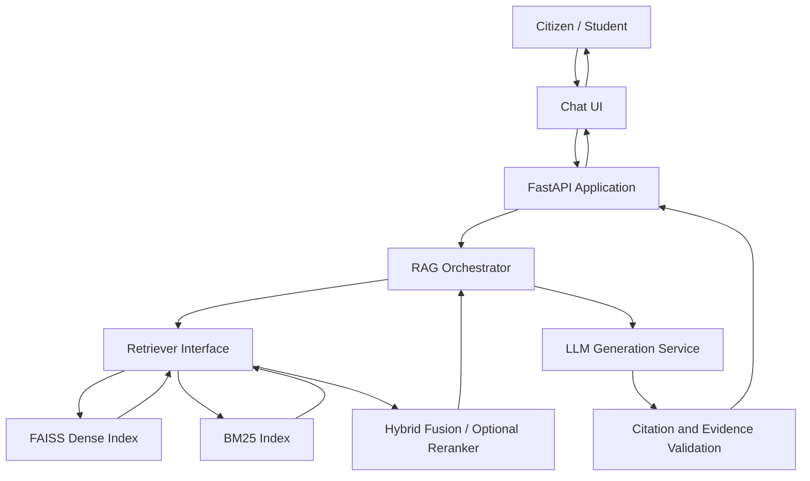
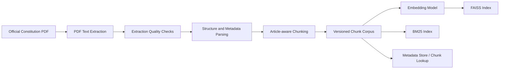
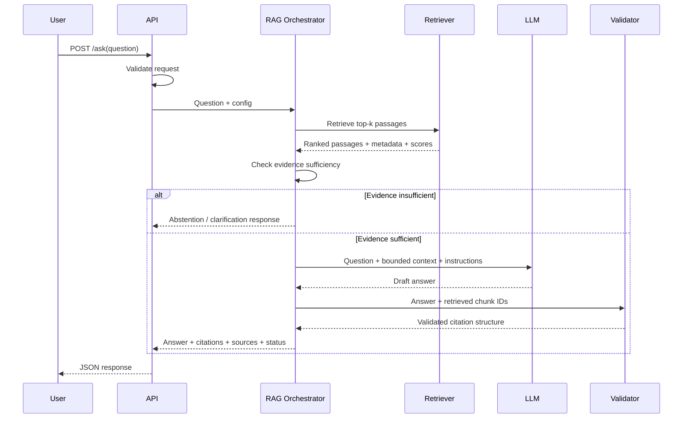

# Architecture — Constitution RAG

## 1. Architecture goals

- Ground answers in retrieved Constitution text.
- Preserve traceability from answer citation to source passage.
- Allow retrieval strategies and LLM providers to be swapped without rewriting the app.
- Make research experiments repeatable.
- Separate ingestion/offline indexing from online question answering.
- Handle weak evidence, failures, and unanswerable questions safely.

## 2. System context



The online path should not parse the original PDF on every question. Ingestion and index building are offline steps; query-time retrieval uses built artifacts.

## 3. Offline ingestion pipeline



### Ingestion responsibilities
1. Download or obtain the official source and record its URL, version/date, and checksum.
2. Extract text with page-level information.
3. Inspect extraction quality, especially Article headings, clause numbering, and page breaks.
4. Parse Article/Part/clause metadata where possible; never infer a label without validation.
5. Produce stable chunk IDs.
6. Save chunks and metadata in a durable format such as JSONL.
7. Build dense and lexical indexes from the same corpus version.
8. Save an index manifest containing corpus version, embedding model, chunk settings, and build timestamp.

## 4. Online query pipeline



Citation validation should confirm that citations point to retrieved chunks and valid corpus metadata. This check cannot, by itself, prove semantic support; human review and citation-accuracy evaluation are still required.

## 5. Component responsibilities

### API layer
- Request/response validation.
- Error mapping and safe logging.
- Exposes the stable public API.
- Does not contain retrieval algorithms or prompt construction.

### RAG orchestrator
- Coordinates query processing, retrieval, evidence sufficiency, generation, and citation validation.
- Accepts retrieval and generation configuration.
- Returns a typed response independent of frontend technology.

### Ingestion service
- PDF extraction, cleaning, structure parsing, chunking, and corpus versioning.
- Runs offline or as a CLI job.
- Fails visibly if source extraction or metadata validation fails.

### Retriever interface
- Supports dense, BM25, and hybrid strategies behind a common interface.
- Returns ordered `RetrievedPassage` records.
- Preserves score, rank, chunk ID, and metadata.
- Does not generate answers.

### Generation service
- Provider-neutral LLM client.
- Receives question and bounded source context.
- Uses a prompt that requires evidence-grounded answers and uncertainty when needed.
- Returns structured output, not arbitrary UI markup.

### Citation validator
- Verifies citation chunk IDs are present in the retrieved set.
- Resolves Article/page/source fields from trusted metadata, not from free-form model claims.
- Marks missing/invalid citations for correction or abstention.
- Does not claim semantic validation solely from identifier matching.

### Evaluation service
- Runs fixed question sets against configurable systems.
- Stores raw outputs and metrics with configuration metadata.
- Keeps evaluation separate from production serving.

### Frontend
- Displays question, answer, Article citations, and supporting passages.
- Clearly distinguishes insufficient evidence and errors.
- Does not invent or modify citations.

## 6. Shared data contracts

### `DocumentChunk`
- `chunk_id: str` — stable unique identifier.
- `text: str` — source passage.
- `article: str | null`
- `part: str | null`
- `clause: str | null`
- `page: int | null`
- `source_title: str`
- `source_url: str`
- `source_version: str`
- Optional: `start_offset`, `end_offset`, `checksum`.

### `RetrievedPassage`
- `chunk: DocumentChunk`
- `score: float`
- `rank: int`
- `retrieval_method: str`

### `Citation`
- `chunk_id: str`
- `article: str | null`
- `page: int | null`
- `source_title: str`
- `source_url: str`

### `AnswerResponse`
- `answer: str`
- `citations: Citation[]`
- `sources: RetrievedPassage[]`
- `insufficient_evidence: bool`
- `request_id: str`
- `retrieval_method: str`
- Optional: `warning: str | null`

Keep public response fields stable. Internal scores need not be exposed to end users unless useful.

## 7. API design

### `GET /health`
Returns service health and version information. It must not expose secrets.

### `POST /ask`
Request:
```json
{
  "question": "What does Article 21 protect?",
  "retrieval_mode": "dense"
}
```

`retrieval_mode` can be optional, with a configured default. Allowed values should be validated, for example `dense`, `bm25`, and `hybrid`.

Response:
```json
{
  "answer": "Answer grounded in retrieved source text.",
  "citations": [
    {
      "chunk_id": "real-chunk-id",
      "article": "verified Article identifier",
      "page": 1,
      "source_title": "Constitution of India",
      "source_url": "official source URL"
    }
  ],
  "sources": [],
  "insufficient_evidence": false,
  "request_id": "generated-request-id",
  "retrieval_method": "dense"
}
```

This is a schema example. Real values must come from the indexed corpus. Define consistent error responses for invalid requests, retrieval failure, and LLM/provider failure.

## 8. Configuration and artifacts

Use environment variables and a typed configuration module for:
- LLM provider/model and API key.
- Embedding model.
- Corpus and index paths.
- Chunk size and overlap.
- Retrieval mode and top-k.
- Hybrid fusion parameters.
- Reranker configuration.
- Evidence sufficiency threshold.
- Request timeout and logging level.

Do not hard-code provider secrets. Do not assume a similarity threshold is valid before calibration. Store a manifest beside generated indexes so mismatched corpus/index versions can be detected.

## 9. Deployment view

Initial development can run as one Python backend plus a separate frontend. FAISS and the corpus may be local files for a small project. Add a hosted vector database or separate worker only if measured needs justify it.

Potential deployment units:
- Frontend static application.
- FastAPI backend.
- Versioned corpus/index artifacts.
- Optional external LLM API.

Use HTTPS in deployment, limit request size, add timeouts, and avoid logging private user data unnecessarily.

## 10. Failure modes and mitigations

| Failure | Mitigation |
|---|---|
| PDF text is malformed | Extraction checks, page inspection, corrected parsing |
| Article metadata is wrong | Validate against source; preserve unknown metadata as null |
| No relevant passage found | Evidence threshold, abstention, suggest rephrasing |
| LLM invents a citation | Construct citations from retrieved metadata and validate IDs |
| Answer not supported by cited passage | Human review, faithfulness/citation metrics, prompt refinement |
| Index and corpus mismatch | Index manifest and version checks |
| LLM API unavailable | Timeout, clear error response, retry only when safe |
| Evaluation leakage | Keep held-out test set separate from tuning data |
| Secrets committed | `.env.example`, `.gitignore`, secret rotation procedures |

## 11. Architecture decisions to record

Create an Architecture Decision Record (ADR) when choosing:
- LLM provider/model.
- Embedding model.
- Chunking strategy.
- FAISS index type and similarity metric.
- Hybrid fusion algorithm.
- Reranker model.
- Frontend framework.
- Deployment target.

For each decision record context, options considered, decision, reason, trade-offs, and date. Do not select a complex service unless it is justified by project needs.
